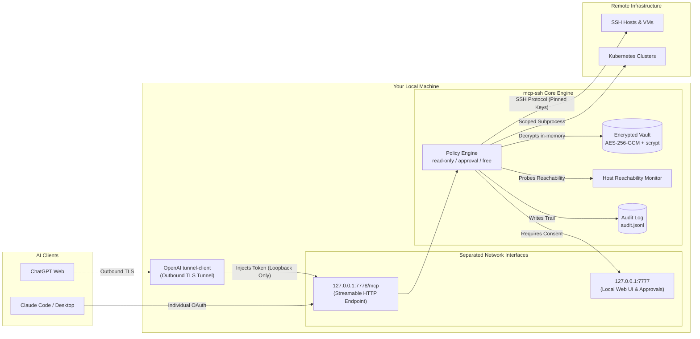

# mcp-ssh-k8s

[](https://modelcontextprotocol.io/)
[](#security-model)
[](https://nodejs.org/)
[](#license)

**mcp-ssh-k8s** is a self-hosted, Zero-Trust gateway that connects AI agents (**Claude Desktop**, **Claude Code CLI**, **Codex Desktop**, **Codex CLI**, **ChatGPT**, **Cursor**, etc.) to your SSH servers and Kubernetes clusters via the [Model Context Protocol](https://modelcontextprotocol.io/).

Instead of granting AI models direct shell access or exposing raw SSH private keys and kubeconfigs, **mcp-ssh** acts as an intermediary. It stores SSH credentials in an AES-256-GCM encrypted local vault, enforces policy controls (`read-only`, `approval`, `free`), records an audit trail, and gives human operators visibility and control over commands executed.

> 📖 **[Ghid complet de utilizare pas cu pas în limba română găsiți aici (docs/GHID_UTILIZARE.md)](docs/GHID_UTILIZARE.md)**

---

## Architecture Overview



---

## Key Features

- 🔐 **Encrypted Vault**: Keys are derived with `scrypt` (N=2¹⁷), and persistent vault contents use `AES-256-GCM`. SSH credentials are decrypted for authorized operations. Kubectl uses a private temporary kubeconfig that is deleted afterward; container and systemd deployments place these temporary files on memory-backed storage.
- 🛡️ **Three Safety Modes Per Host/Cluster**:
  - `read-only`: Strictly limits AI to harmless inspection commands (`uptime`, `free`, `df`, `cat`, `kubectl get`, `kubectl describe`, etc.). Rejects shell chaining (`&&`, `;`, `|`, `` ` ``), redirects (`>`, `<`), and blocks reading Kubernetes secrets or streaming commands (`-f`, `-w`).
  - `approval`: Every proposed command is placed in an interactive queue in the Web UI. The AI pauses execution until a human operator clicks **Approve** or **Deny**.
  - `free`: Unrestricted execution for non-critical development hosts.
- ☸️ **Kubernetes (kubectl) Integration**: Upload raw kubeconfigs (stored encrypted in the vault). The AI gets access to `list_clusters` and `kubectl` tools with strict parameter sanitization—preventing privilege escalation flags like `--kubeconfig`, `--token`, `--server`, `cp`, `proxy`, or reading sensitive local files.
- 📡 **Active Host Health Monitoring**: Continuously tests TCP reachability in the background. Hosts that are offline or unreachable are automatically excluded from the MCP tool catalog, preventing the AI from getting stuck on timed-out connections.
- 📦 **Seamless Importers**:
  - OpenSSH `~/.ssh/config` parser (including imported `IdentityFile` keys).
  - Termius CSV export importer.
  - **Offline Local Termius Desktop Importer** (Windows): Reads Termius' local IndexedDB without cloud access, decrypts credentials via the Windows Credential Manager key, and securely imports hosts, tags, passwords, and SSH keys.
- 📝 **Audit Trail**: Command decisions and execution outcomes are appended to `data/audit.jsonl`. Common inline credential formats are redacted. The local file is not immutable or cryptographically tamper-evident; use an external protected log collector when required. Avoid secrets in command text.
- 🔒 **Auto-Lock Security Timer**: Automatically seals the vault after an idle timeout. OAuth and authenticated tool discovery stay available; resource operations return an MCP tool error with the vault UI address until the user unlocks the vault.

---

## Why Run Locally? & Why the OpenAI Secure Tunnel?

### 1. The Local-Only Principle (Zero-Trust Security)

Running `mcp-ssh` locally on your workstation is the foundational security guarantee of this system:

1. **No Third-Party Secret Storage**: Your SSH private keys, bastion credentials, root passwords, and cloud kubeconfigs remain exclusively on your physical machine. They are never uploaded to a third-party SaaS or intermediary server.
2. **Loopback Administration by Default**: The internal Admin Web UI ([http://127.0.0.1:7777](http://127.0.0.1:7777)) listens **only on loopback (`127.0.0.1`)**. Workstation mode is local. Server deployments intentionally provide authenticated remote access through the optional HTTPS gateway/reverse proxy, with individual accounts, MFA and resource policies. Initial administrator bootstrap remains loopback-only.
3. **Defense Against Prompt Injection**: If a rogue LLM prompt or compromised dependency instructs the AI to exfiltrate private keys, `mcp-ssh` rejects the request: tool descriptions and endpoints never return private keys or raw kubeconfigs.

---

### 2. Individual OAuth, including through Secure MCP Tunnel

All clients authenticate with their own application account and MFA. Installing a connector in a workspace grants no host access. OAuth tokens identify the user; grants on stable host/cluster IDs control access. New members have no grants.

OpenAI Secure MCP Tunnel provides private connectivity and forwards the individual OAuth credential. It no longer injects a shared bearer token. Choose **OAuth** in ChatGPT. The authorization service must be separately reachable through HTTPS; the tunnel does not automatically publish the login pages.

See [authentication and migration](docs/AUTHENTICATION.md) for deployment and recovery instructions.

Administrators manage the shared tunnel, private HTTPS/Cloudflare and component installers at **`/identity/admin`**. These instance controls require an administrator session and CSRF protection and work while personal vaults are locked. Members cannot invoke installers or read server-local SSH/Termius files; CSV uploads remain available for their own vaults.

Gemini Web and Claude Web can share a public HTTPS endpoint through the **Cloudflare web tunnel** in the same admin page. Open the API token creation link, save your API token (or Global API Key with email), select an active domain and subdomain, and choose **Create and connect — 1 click**. The application installs the verified `cloudflared` runtime, creates a managed tunnel and proxied DNS record, configures ingress to the loopback MCP port, activates OAuth discovery without restarting and starts the connection. Credentials are encrypted and partial setup can be resumed without duplicating resources. The auto-connect checkbox controls startup at the next application launch. Existing `AUTH_URL` and `MCP_PUBLIC_URL` environment settings must match the chosen hostname. Manual setup with an existing tunnel token remains available. Adding the connector and authorizing the individual account still happen in Gemini or Claude. See [web connection setup](docs/WEB_CLIENTS.md).

## Installation & Quick Start

### Docker, Kubernetes and Linux services

See [deployment instructions](docs/DEPLOYMENT.md) for Docker Compose, Kubernetes with TLS ingress and persistent storage, and a hardened Linux systemd service. The optional external gateway keeps administration and MCP listeners on loopback. Container builds exclude local vaults and credentials, run as UID 1000 with a read-only root filesystem, and expose health/readiness probes.

The default container target requires an Ed25519-signed application manifest. Release workflows are archived under `.github/workflows-disabled/`; only security checks on push are active, following the repository CI policy. The [container release workflow](.github/workflows-disabled/release-container.yml) tests the same Linux amd64 image in Docker and a temporary Kubernetes cluster, blocks HIGH/CRITICAL CVEs, and publishes to GHCR with provenance, an SBOM and deployment manifests pinned to its digest. See [container release setup](docs/CONTAINER_RELEASE.md) for the protected CI signing secret and installation. Unsigned development builds require the explicit `runtime-dev` target. Integrity incidents stop the process and remain recorded on the data volume/PVC across restarts.

Read the [security review and outstanding findings](docs/SECURITY_REVIEW.md) before production deployment. Kubeconfig credential helpers, insecure TLS, local file references, and URL manifests are rejected, including in previously stored configurations. Use embedded short-lived credentials and enforce least privilege at the target cluster too.

### Windows installer (recommended)

Download the **[latest Windows installer](https://github.com/edward1987/mcp-ssh-k8s/releases/latest)**. Node.js is included. During setup, choose your data folder and whether to **start automatically with Windows as a service**.

Already using this project? Stop the old instance and select its existing `data` folder (the one containing `vault.json`). Setup backs up and reuses your vault and audit history; your master password remains the same; legacy MCP tokens are invalidated on unlock. The vault must be unlocked in the browser after each restart. Uninstalling preserves your data.

**[Windows installation and existing database guide / Ghid Windows (RO)](docs/WINDOWS_INSTALL.md)**

### Prerequisites
- **Node.js**: `24.22.2+` in the Node 24 LTS line (or supported Node 26.13+). Node 20 is not supported; authentication uses built-in `node:sqlite`.
- **npm**: `v9.x` or higher
- **Optional**:
  - `kubectl` in your system `PATH` (for Kubernetes management)
  - Python 3.10+ (only if using the automated local Termius desktop importer)

### 1. Clone & Install

```bash
git clone https://github.com/edward1987/mcp-ssh-k8s.git
cd mcp-ssh-k8s
npm ci --ignore-scripts
```

### 2. Build & Launch

```bash
# Development mode (auto-reload via tsx)
npm run dev

# Production build
npm run build
npm start
```

### 3. Initialize accounts and unlock the vault

1. Open [the local administration UI](http://127.0.0.1:7777), select initial administrator setup, and enter the existing vault master password (or choose one for a new vault).
2. Activate the administrator account with a separate password and TOTP. Save the recovery codes.
3. Sign in, open the vault UI and unlock the vault with its master password. It remains locked after each restart.
4. Add hosts/clusters, then use **Conturi si acces** to invite members and assign direct or group grants. The existing host `group` label is separate from security groups.

See [personal vaults, revocable sharing and private HTTPS with Cloudflare DNS-01](docs/PERSONAL_VAULTS.md) for the current multi-user deployment and migration model.

## Client Integration

The **Clienti AI** page generates OAuth configurations without credentials in workspace files. Claude Code and Codex use native HTTP OAuth; Claude Desktop uses the bundled stdio bridge, which prints a browser authorization URL to MCP stderr. Its credentials live in the OS user's home directory, outside the workspace.

```sh
claude mcp add --scope user --transport http ssh http://127.0.0.1:7778/mcp
claude mcp login ssh
```

For ChatGPT, select the HTTPS endpoint or Secure MCP Tunnel and **OAuth**. Every workspace member connects their own application account. Configure `AUTH_URL` and `MCP_PUBLIC_URL` as described in [the deployment guide](docs/AUTHENTICATION.md).

## Available MCP Tools

AI models connected via `mcp-ssh` have access to the following scoped tools:

| Tool | Parameters | Description | Safety Protections |
| :--- | :--- | :--- | :--- |
| `list_hosts` | *none* | Returns a JSON array of reachable hosts (name, address, user, tags, mode). | Offline hosts are automatically excluded; secrets are never returned. |
| `get_security_checklist` | *none* | Lists hosts added to the security checklist with their status, notes, and guidelines. | Secrets excluded; returns target hosts and audit inspection guidelines. |
| `run_security_check` | `host`, `focus` | Performs an automated read-only security audit (auth logs, failed logins, ports, services, disk). | Read-only non-intrusive audit commands; single approval in approval mode. |
| `run_command` | `host`, `command`, `timeout_seconds` | Runs a shell command on the specified host and returns stdout, stderr, and exit code. | Filtered by policy (`read-only` allowlist, human `approval` queue, or `free`). |
| `read_file` | `host`, `path` | Reads a file via `cat -- <path>`, subject to the host policy and output limit. | Read-only policy rejects shell metacharacters. Files accessible to the remote SSH user may contain secrets; use a least-privilege account. |
| `get_host_info` | `host` | Collects vital server stats (OS, kernel, uptime, RAM, disks, listening ports, Docker containers). | Safe, standardized read-only telemetry inspection. |
| `list_clusters` | *none* | Lists available Kubernetes clusters (name, context, default namespace, mode). | Credentials and cluster certificates are stripped from output. |
| `kubectl` | `cluster`, `args`, `manifest`, `timeout_seconds` | Runs `kubectl` against a stored cluster. | Disallows local file access, `--kubeconfig`, `--token`, and `--raw`. In `read-only` mode, secret resources and `--watch` are strictly forbidden. |

---

## Security Model

```
+---------------------------------------------------------------------------------+
|                                 SECURITY MATRIX                                 |
+---------------------+-------------------+------------------+--------------------+
| Feature             | Read-Only Mode    | Approval Mode    | Free Mode          |
+---------------------+-------------------+------------------+--------------------+
| Shell Metachars     | Blocked (; && |)  | Allowed          | Allowed            |
| Shell Redirection   | Blocked (> >> <)  | Allowed          | Allowed            |
| Command Execution   | Allowlist Only    | Human Approval   | Immediate          |
| K8s Secrets Access  | Strictly Blocked  | Human Approval   | Allowed            |
| K8s Watch/Follow    | Blocked (-w, -f)  | Allowed          | Allowed            |
| Kubeconfig Tamper   | Blocked (--token) | Blocked          | Blocked            |
| Audit Logging       | Full Trace        | Full Trace       | Full Trace         |
+---------------------+-------------------+------------------+--------------------+
```

- **Vault Key Derivation**: Scrypt parameters: `N = 131072` (2¹⁷), `r = 8`, `p = 1`, output length 32 bytes, with a cryptographically random 16-byte salt.
- **Host Key Pinning**: TOFU (Trust On First Use) model. SSH host keys are pinned into the vault during the first connection; if a remote host key changes, execution is aborted to prevent MITM attacks.
- **CSRF & Session Security**: Admin endpoints require a cryptographically random CSRF token issued per browser session.
- **Rate Limiting**: Login, vault and MCP authentication attempts are throttled. Server deployments should also enforce per-client limits at the HTTPS reverse proxy.

---

## Environment Variables

| Variable | Default | Purpose |
| :--- | :--- | :--- |
| `ADMIN_PORT` | `7777` | Port for the Admin Web UI & Approval queue (binds strictly to `127.0.0.1`). |
| `MCP_PORT` | `7778` | Port for the Streamable HTTP MCP server endpoint. |
| `AUTH_URL` | `http://127.0.0.1:7778` | Canonical authorization service origin; HTTPS for remote deployment. |
| `MCP_PUBLIC_URL` | `http://127.0.0.1:7778/mcp` | Canonical OAuth resource URL, matching the client endpoint. |
| `MCP_SSH_DATA` | `./data` | Directory where `vault.json`, `audit.jsonl`, and local binaries reside. |
| `KUBECTL_PATH` | `kubectl` | Path to the `kubectl` binary on the host machine. |
| `GATEWAY_PORT` | unset (container: `8080`) | Opt-in HTTP backend for a TLS reverse proxy; requires HTTPS URLs at the same origin. |
| `GATEWAY_BIND` | `127.0.0.1` (container: `0.0.0.0`) | Gateway bind IP. Publish only to a local TLS proxy or isolated pod network. |

---

## Development & Testing

The web control center includes a responsive dashboard, SSH search and policy filters, dark/light themes, and account/access forms. Assets are served locally with a strict CSP; background polling does not renew idle sessions. See [authentication](docs/AUTHENTICATION.md) for deployment and session behavior.

Run `npm run test:browser` for the browser security and interface checks. Windows uses the installed Microsoft Edge by default; on other systems install Chromium with `npx playwright install chromium`. Set `PLAYWRIGHT_CHANNEL=chrome` to use an installed Chrome browser. Tests use isolated temporary data and synthetic credentials.

```bash
# Run unit and end-to-end test suite (vitest)
npm test

# Build TypeScript to dist/
npm run build

# Start production server
npm start
```

---

## License

This project is licensed under the [MIT License](LICENSE).
