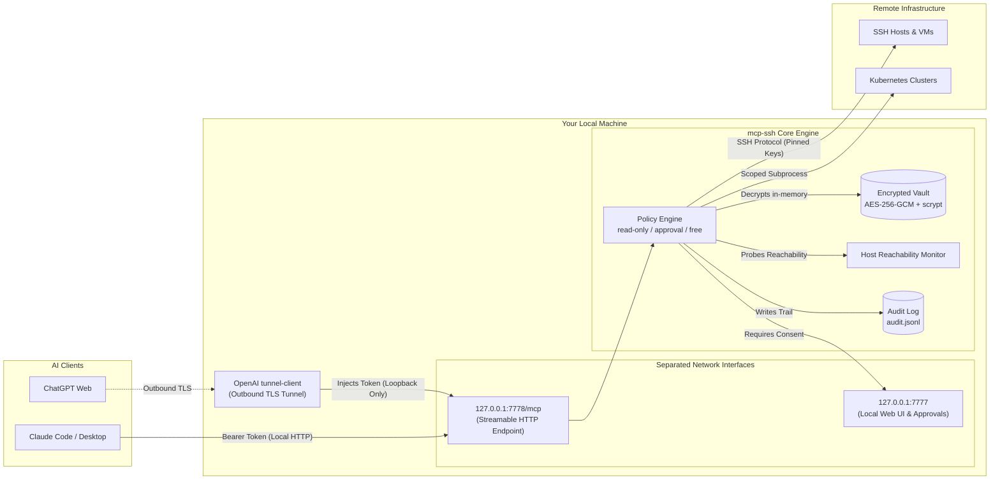

# mcp-ssh

[](https://modelcontextprotocol.io/)
[](#security-model)
[](https://nodejs.org/)
[](#license)

**mcp-ssh** is a self-hosted, Zero-Trust gateway that connects AI agents (**Claude Code**, **Claude Desktop**, **ChatGPT**, **Cursor**, etc.) to your SSH servers and Kubernetes clusters via the [Model Context Protocol](https://modelcontextprotocol.io/).

Instead of granting AI models direct shell access or exposing raw SSH private keys and kubeconfigs, **mcp-ssh** acts as an intelligent intermediary. It stores all credentials in an AES-256-GCM encrypted local vault, enforces granular policy controls (`read-only`, `approval`, `free`), maintains an immutable audit trail, and gives human operators full visibility and control over every command executed.

---

## Architecture Overview



---

## Key Features

- 🔐 **Zero-Exposure Encrypted Vault**: Master password encrypted with `scrypt` (N=2¹⁷) + `AES-256-GCM`. Private keys, passwords, and kubeconfigs are never stored in plaintext on disk and are decrypted only ephemerally in RAM when executing approved commands.
- 🛡️ **Three Safety Modes Per Host/Cluster**:
  - `read-only`: Strictly limits AI to harmless inspection commands (`uptime`, `free`, `df`, `cat`, `kubectl get`, `kubectl describe`, etc.). Rejects shell chaining (`&&`, `;`, `|`, `` ` ``), redirects (`>`, `<`), and blocks reading Kubernetes secrets or streaming commands (`-f`, `-w`).
  - `approval`: Every proposed command is placed in an interactive queue in the Web UI. The AI pauses execution until a human operator clicks **Approve** or **Deny**.
  - `free`: Unrestricted execution for non-critical development hosts.
- ☸️ **Kubernetes (kubectl) Integration**: Upload raw kubeconfigs (stored encrypted in the vault). The AI gets access to `list_clusters` and `kubectl` tools with strict parameter sanitization—preventing privilege escalation flags like `--kubeconfig`, `--token`, `--server`, `cp`, `proxy`, or reading sensitive local files.
- 📡 **Active Host Health Monitoring**: Continuously tests TCP reachability in the background. Hosts that are offline or unreachable are automatically excluded from the MCP tool catalog, preventing the AI from getting stuck on timed-out connections.
- 📦 **Seamless Importers**:
  - OpenSSH `~/.ssh/config` parser (including imported `IdentityFile` keys).
  - Termius CSV export importer.
  - **Offline Local Termius Desktop Importer** (Windows): Reads Termius' local IndexedDB without cloud access, decrypts credentials via the Windows Credential Manager key, and securely imports hosts, tags, passwords, and SSH keys.
- 📝 **Tamper-Evident Audit Trail**: Every tool invocation, command, operator decision, exit code, execution latency, and error is appended to `data/audit.jsonl` (with all secrets redacted).
- 🔒 **Auto-Lock Security Timer**: Automatically seals the vault after an idle timeout. When sealed, the MCP endpoint returns `503 Service Unavailable` until unlocked with the master password.

---

## Why Run Locally? & Why the OpenAI Secure Tunnel?

### 1. The Local-Only Principle (Zero-Trust Security)

Running `mcp-ssh` locally on your workstation is the foundational security guarantee of this system:

1. **No Third-Party Secret Storage**: Your SSH private keys, bastion credentials, root passwords, and cloud kubeconfigs remain exclusively on your physical machine. They are never uploaded to a third-party SaaS or intermediary server.
2. **True Air-Gapped Authorization**: The Admin Web UI ([http://127.0.0.1:7777](http://127.0.0.1:7777)) is hard-coded to listen **only on the loopback interface (`127.0.0.1`)**. It cannot be reached from your local LAN or the internet. Only you, sitting at your physical computer, can unlock the vault or approve sensitive commands.
3. **Defense Against Prompt Injection**: If a rogue LLM prompt or compromised dependency instructs the AI to exfiltrate private keys, `mcp-ssh` rejects the request: tool descriptions and endpoints never return private keys or raw kubeconfigs.

---

### 2. The ChatGPT Challenge & OpenAI Secure MCP Tunnel

Connecting ChatGPT Web to a local MCP server presents a unique architectural problem:

- **The Problem with ChatGPT Custom MCP**: Unlike developer tools (such as Claude Code or Claude Desktop) that run locally or let you supply custom HTTP headers (`Authorization: Bearer <secret>`), ChatGPT Web connects from OpenAI's cloud servers and only supports **OAuth 2.0** or **No Authentication**.
- **The Pitfall of Naive Port Forwarding (e.g. ngrok, public Cloudflare)**: If you expose your local MCP server to the public internet without authentication to satisfy ChatGPT, **anyone who discovers the URL can execute commands on your servers**.
- **The Solution: OpenAI Secure MCP Tunnel (`tunnel-client`)**:
  `mcp-ssh` includes a built-in manager for OpenAI's official open-source [`tunnel-client`](https://github.com/openai/tunnel-client):

```
[ChatGPT Web (OpenAI Cloud)]
            │  (Connection: Tunnel, Auth: None)
            ▼
[OpenAI Hosted Tunnel Gateway]
            │
            │  Outbound TLS Tunnel (Established from inside your network)
            ▼
[Local `tunnel-client` runtime on your PC]
            │
            │  Injects: Authorization: Bearer <chatgpt-tunnel-token>
            ▼
[mcp-ssh MCP Server (127.0.0.1:7778)]
```

#### Why this architecture is superior:
- 🚀 **Zero Inbound Ports / No Firewall Openings**: The tunnel client establishes an **outbound** TLS connection to OpenAI. You do not need to open router ports, configure port forwarding, or set up dynamic DNS.
- 🔑 **Tokens Never Leave Your Machine**: ChatGPT is configured with *No Authentication*. Instead, your local `tunnel-client` injects a dedicated bearer token (`chatgpt-tunnel`) inside your loopback interface before the request hits `mcp-ssh`. The secret token never touches OpenAI's servers or the public internet.
- ⚡ **Instant Kill-Switch**: You can revoke the `chatgpt-tunnel` token with a single click in the **Tokens** tab of the Admin UI, cutting off ChatGPT's access immediately without stopping the server or disturbing other clients.
- 🔎 **Automated & Verified**: The Admin UI downloads the official `tunnel-client` binary directly from OpenAI's GitHub releases, verifies its SHA-256 hash, and monitors its health and runtime logs automatically.

---

## Installation & Quick Start

### Prerequisites
- **Node.js**: `v20.x` or higher
- **npm**: `v9.x` or higher
- **Optional**:
  - `kubectl` in your system `PATH` (for Kubernetes management)
  - Python 3.10+ (only if using the automated local Termius desktop importer)

### 1. Clone & Install

```bash
git clone https://github.com/<your-username>/mcp-ssh.git
cd mcp-ssh
npm install
```

### 2. Build & Launch

```bash
# Development mode (auto-reload via tsx)
npm run dev

# Production build
npm run build
npm start
```

### 3. Initialize the Vault
1. Open your browser and navigate to **[http://127.0.0.1:7777](http://127.0.0.1:7777)**.
2. On your first visit, enter a strong master password (minimum 12 characters). This password derives your vault encryption key via `scrypt`.
3. Add your SSH hosts or import them via the **Import** tab (`~/.ssh/config`, Termius CSV, or local Termius desktop app).
4. Navigate to the **Tokens** tab and generate a new MCP client token (e.g. for `claude-code`).

---

## Client Integration

### Claude Code CLI

Add the server using the Streamable HTTP transport:

```bash
claude mcp add --transport http ssh http://127.0.0.1:7778/mcp --header "Authorization: Bearer <YOUR_MCP_TOKEN>"
```

### Claude Desktop

Edit your `claude_desktop_config.json`:

```json
{
  "mcpServers": {
    "ssh": {
      "command": "npx",
      "args": [
        "-y",
        "mcp-remote",
        "http://127.0.0.1:7778/mcp",
        "--header",
        "Authorization: Bearer <YOUR_MCP_TOKEN>"
      ]
    }
  }
}
```

### ChatGPT (via OpenAI Secure MCP Tunnel)

1. Go to [platform.openai.com/settings/organization/tunnels](https://platform.openai.com/settings/organization/tunnels).
2. Create a tunnel, associate it with your ChatGPT workspace, and copy the **Tunnel ID** (format: `tunnel_...`).
3. Create an OpenAI API Key with `Tunnels: Read & Use` permissions.
4. In the `mcp-ssh` Web UI ([http://127.0.0.1:7777](http://127.0.0.1:7777)), go to the **ChatGPT** tab:
   - Paste the **Tunnel ID** and **API Key**, then click **Save**.
   - Click **Install Tunnel Client** followed by **Start Tunnel**.
5. In ChatGPT:
   - Go to **ChatGPT Settings** > **Connected Apps** / **Plugins** > **+ Add custom MCP server**.
   - Connection Type: **Tunnel** > select your tunnel.
   - Authentication: **No authentication** (handled locally by `tunnel-client`).
   - Click **Create**. ChatGPT will immediately discover your hosts and Kubernetes clusters!

---

## Available MCP Tools

AI models connected via `mcp-ssh` have access to the following scoped tools:

| Tool | Parameters | Description | Safety Protections |
| :--- | :--- | :--- | :--- |
| `list_hosts` | *none* | Returns a JSON array of reachable hosts (name, address, user, tags, mode). | Offline hosts are automatically excluded; secrets are never returned. |
| `run_command` | `host`, `command`, `timeout_seconds` | Runs a shell command on the specified host and returns stdout, stderr, and exit code. | Filtered by policy (`read-only` allowlist, human `approval` queue, or `free`). |
| `read_file` | `host`, `path`, `max_bytes` | Reads a text file safely via `cat -- <path>`. | Read-only mode validates file access; binary files or paths with metacharacters are rejected. |
| `get_host_info` | `host` | Collects vital server stats (OS, kernel, uptime, RAM, disks, listening ports, Docker containers). | Safe, standardized read-only telemetry inspection. |
| `list_clusters` | *none* | Lists available Kubernetes clusters (name, context, default namespace, mode). | Credentials and cluster certificates are stripped from output. |
| `kubectl` | `cluster`, `args`, `manifest`, `timeout_seconds` | Runs `kubectl` against a stored cluster. | Disallows local file access, `--kubeconfig`, `--token`, and `--raw`. In `read-only` mode, secret resources and `--watch` are strictly forbidden. |

---

## Security Model

```
+---------------------------------------------------------------------------------+
|                                 SECURITY MATRIX                                 |
+---------------------+-------------------+------------------+--------------------+
| Feature             | Read-Only Mode    | Approval Mode    | Free Mode          |
+---------------------+-------------------+------------------+--------------------+
| Shell Metachars     | Blocked (; && |)  | Allowed          | Allowed            |
| Shell Redirection   | Blocked (> >> <)  | Allowed          | Allowed            |
| Command Execution   | Allowlist Only    | Human Approval   | Immediate          |
| K8s Secrets Access  | Strictly Blocked  | Human Approval   | Allowed            |
| K8s Watch/Follow    | Blocked (-w, -f)  | Allowed          | Allowed            |
| Kubeconfig Tamper   | Blocked (--token) | Blocked          | Blocked            |
| Audit Logging       | Full Trace        | Full Trace       | Full Trace         |
+---------------------+-------------------+------------------+--------------------+
```

- **Vault Key Derivation**: Scrypt parameters: `N = 131072` (2¹⁷), `r = 8`, `p = 1`, output length 32 bytes, with a cryptographically random 16-byte salt.
- **Host Key Pinning**: TOFU (Trust On First Use) model. SSH host keys are pinned into the vault during the first connection; if a remote host key changes, execution is aborted to prevent MITM attacks.
- **CSRF & Session Security**: Admin endpoints require a cryptographically random CSRF token issued per browser session.
- **Rate-Limiting & Fail2Ban**: Failed master password and MCP token attempts are throttled with exponential backoff to thwart brute-force attempts.

---

## Environment Variables

| Variable | Default | Purpose |
| :--- | :--- | :--- |
| `ADMIN_PORT` | `7777` | Port for the Admin Web UI & Approval queue (binds strictly to `127.0.0.1`). |
| `MCP_PORT` | `7778` | Port for the Streamable HTTP MCP server endpoint. |
| `MCP_BIND` | `127.0.0.1` | Network interface for the MCP endpoint (`127.0.0.1` recommended). |
| `MCP_SSH_DATA` | `./data` | Directory where `vault.json`, `audit.jsonl`, and local binaries reside. |
| `KUBECTL_PATH` | `kubectl` | Path to the `kubectl` binary on the host machine. |

---

## Development & Testing

```bash
# Run unit and end-to-end test suite (vitest)
npm test

# Build TypeScript to dist/
npm run build

# Start production server
npm start
```

---

## License

This project is licensed under the [MIT License](LICENSE).
